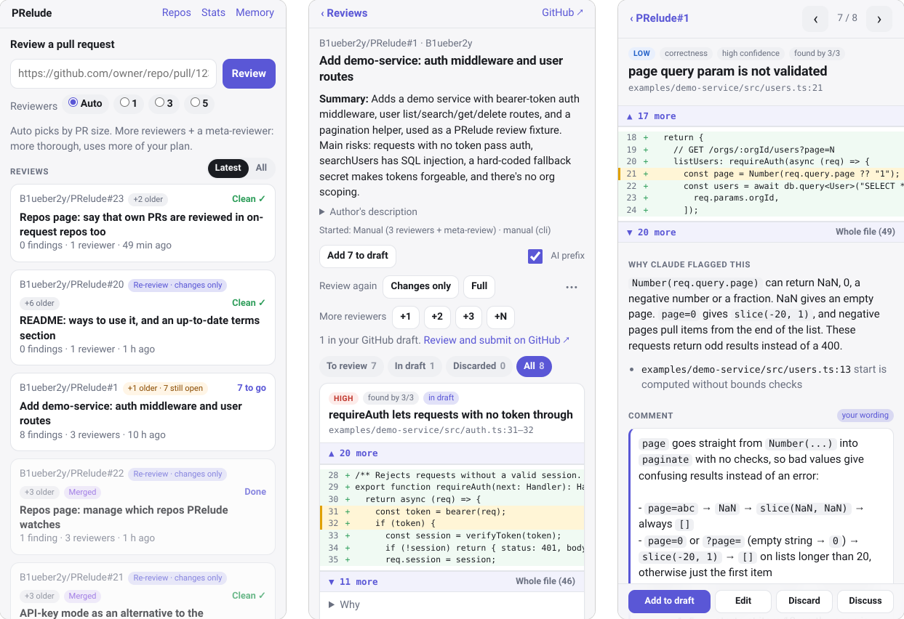

# PRelude

**Meta-review a panel of independent AI code reviewers before their comments land on the PR**, for better collaboration with AI in daily coding and reviewing life on GitHub (a harness around [Claude Code](#built-on-claude-code)).

A small personal project built on Claude Code. **Note that for code review as a team, Anthropic's
[Code Review](https://code.claude.com/docs/en/code-review) is the natural choice and this project
is not applicable.**

<h3 align="center">Laptop</h3>
<p align="center">
  
</p>
<h3 align="center">Phone</h3>
<p align="center">
  
</p>

AI reviewers are good at finding problems and bad at knowing which ones matter to *you*.
Posting their output straight onto a pull request is noisy; pasting it into one long chat
is unmanageable. PRelude treats an AI review the way we treat code: as a proposal that
gets reviewed.

Claude reads the pull request and proposes review comments. You are the meta-reviewer: you
go through each comment, push back where it's wrong, and decide what the author actually
sees. It works the way you'd review a change:

| Code review              | PRelude                                              |
| ------------------------ | ---------------------------------------------------- |
| A contributor opens a PR | Claude proposes a set of review comments             |
| Approve                  | **Add** the comment to your GitHub draft review      |
| Suggest changes          | **Edit** the wording                                 |
| Comment thread           | **Discuss** it with Claude, many threads at once     |
| Reject                   | **Discard** it                                       |
| Release                  | You add your own comments and submit on GitHub       |
| The contributor improves | PRelude **remembers** your principles and style      |

Nothing is published by PRelude. Comments land in your *pending* GitHub review, which only
you can see. New comments start there and you discard the ones you don't want (with
`github_drafts.auto: false` they wait for you to add them). Then, on GitHub, you add any
comments of your own and submit the review yourself (Comment / Approve / Request changes).
Optionally, each comment is prefixed with `AI review:` so authors know where it came from.

**Discussions run in parallel.** You don't wait for Claude's reply: send, move on to the next
comment, and come back. Each PR has a discussion page that indexes every live comment as a
thread, with the ones that have a new reply first, plus threads of your own about anything
else in the PR. Claude replies to all of them in parallel (with a phone notification if you set
one up).

## Ways to use it

PRelude fits wherever you'd want a careful second reviewer:

- **Review your own PRs during your own development** (surprisingly useful in practice). Open a PR and have PRelude review it
  (paste the link, or turn on `triggers` and your own non-draft PRs are reviewed
  automatically). Fix what's right, push, tap **Review again → Changes only**, and repeat
  until the re-review comes back clean. This pairs well with a coding
  agent: one Claude writes the change, another reviews it, and you judge both. PRelude is
  developed this way: every PR in this repo went through several such rounds.
- **Get a second opinion on a risky change.** Ask for a panel (3 or 5 reviewers, or add
  more later with **+N**) and see which problems several reviewers found independently.
- **Answer review requests faster.** With `triggers` on, when a colleague requests your
  review, a draft is waiting by the time you look; you keep, reword or drop each comment
  and submit.
- **Ask Claude about a PR while you work through it.** On the PR's discussion page, every
  comment is a thread (push back there and Claude can revise or withdraw it), and so is
  each question of your own, like how a change works or whether a case is covered. They
  run in parallel: ask, move on, and come back to the answers.
- **First pass on contributions to a project you maintain.** Turn on `triggers`, add your
  repos on the **Repos** page, and PRelude prepares a review of each new PR; contributors
  only see what you approved.

All of it works from the phone, a laptop browser, or the terminal (`prelude findings`,
`prelude draft`, `prelude discard`, … see [From the terminal](#from-the-terminal)).

## Built on Claude Code

PRelude is a harness around [Claude Code](https://claude.com/claude-code), not a model or
reviewer of its own. Every review, discussion and memory update is a headless run of the
official `claude` CLI, using your own Claude Code login (a Claude subscription); PRelude
supplies the prompts, the read-only sandbox and the workflow around the results:

- **Claude Code does the thinking:** reading the PR and the surrounding code, finding
  problems, drafting comments, and answering when you push back.
- **PRelude does everything else:** deciding what to review, checking out the PR read-only,
  running independent reviewers and merging their reports, keeping one conversation per
  finding (forked Claude Code sessions), learning your preferences, the phone UI, and
  writing comments only into your private pending GitHub review.

So review quality follows Claude Code's, and usage counts against your Claude plan.

### Use within Anthropic's terms

PRelude is an independent project, not made or endorsed by Anthropic, and this section is
not legal advice. Read the current [Consumer Terms](https://www.anthropic.com/legal/consumer-terms),
the [Claude Code legal and compliance](https://code.claude.com/docs/en/legal-and-compliance)
page and your plan's help pages yourself; they changed several times in 2026. You're
responsible for using PRelude in line with Anthropic's terms and your plan; like the rest of
the software, this guidance comes without warranty (see the [License](LICENSE)). As of
October 2026:

- **Scripted use of your own subscription is documented.** The Consumer Terms forbid
  automated access "except when you are accessing our Services via an Anthropic API Key or
  where we otherwise explicitly permit it". Anthropic's own docs show subscription-backed
  scripted use: `claude setup-token` is "for CI pipelines and scripts", the GitHub Actions
  guide reviews every new PR on a subscription token, and the help center says `claude -p`
  can be used "with your subscription limits". PRelude does the same on your machine: it
  runs the unmodified `claude` CLI under your own login and never reads or stores your
  subscription login (in API-key mode it keeps only the key you give it).
- **Don't run it for other people.** Subscriptions may not be shared or used "on behalf of"
  other users, and products built on Claude should use an API key. Keep PRelude personal:
  your login, your machine, your reviews. For heavier personal use, switch to an
  [API key](#subscription-or-api-key) (billed per token).
- **Keep it ordinary, individual usage.** Pro and Max limits "assume ordinary, individual
  usage", and Anthropic can cap heavy or always-on background use. PRelude finds PRs for
  you but runs Claude only when you start a review; starting them unattended
  (`triggers.auto_start`) is off by default. If you turn it on, check Anthropic's terms on
  automated use, and keep `max_reviews_per_day` and reviewer panels modest. PRelude doesn't
  retry when Claude reports a usage limit.
- **Built to complement Anthropic's tools.** PRelude exists thanks to Claude Code and is
  meant to work alongside Anthropic's own offerings, such as [Code
  Review](https://code.claude.com/docs/en/code-review) for Team and Enterprise plans and the
  open-source GitHub Action. It is a small, free, non-commercial project for one person's
  own reviews: it runs on each user's own Claude plan or API key and isn't offered as a
  service. For reviewing as a team, Anthropic's Code Review is designed for exactly that.

## Install and run

### 1. Install

You need Python 3.12+, [Claude Code](https://claude.com/claude-code) logged in with your
Claude subscription (`claude auth status`; or an Anthropic API key, see below) and the
GitHub CLI logged in (`gh auth status`). Then:

```bash
git clone https://github.com/B1ueber2y/PRelude.git && cd PRelude
python3 -m venv .venv
.venv/bin/pip install -e ".[dev]"
.venv/bin/prelude auth        # checks the Claude login PRelude will use
```

Data (database, checkouts, memory, config) lives in `.prelude-data/` unless `PRELUDE_HOME`
is set; settings are in `.prelude-data/config.yaml`. To try PRelude on a single repo
first, set `only_repo: OWNER/REPO` there; it then refuses every other repository.

### 2. Start it

```bash
.venv/bin/prelude start       # in the background; `prelude stop` / `prelude status`
.venv/bin/prelude             # or in the foreground; Ctrl+C stops it
```

PRelude serves its web UI on `127.0.0.1:8787` only, and runs nothing until you start it.

### 3. Open it on a computer

Run `.venv/bin/prelude url` and open the link once (`http://127.0.0.1:8787/?key=…`); after
that `http://127.0.0.1:8787` is enough in that browser (`localhost` won't work).

From a laptop, when PRelude runs on another machine: in a terminal **on the laptop**, run
`ssh -N -L 8787:127.0.0.1:8787 you@that-machine` and keep it open, then open the
`prelude url` link (run it on the machine) **in the laptop's browser**. If the page
can't be reached, the tunnel isn't up.

On a laptop the review page is a split view; `j`/`k` move between findings and `a`/`e`/`d`
add, edit or discard.

### 4. (Optional) Set up your phone

1. **Reach it privately.** PRelude never listens on the network. Forward the port from the
   phone: in an SSH app such as Termius, add the machine as a host and a *local port
   forward* from 8787 to `127.0.0.1:8787` (keep-alive on helps).
2. **Unlock it once.** Open the `prelude url` link in the phone's browser.
3. **Add it to the home screen.** iPhone: Safari → Share → *Add to Home Screen*. Android:
   Chrome → ⋮ → *Add to Home screen*. It then opens like an app.
4. **Notifications (optional).** Run `.venv/bin/prelude notify-setup`, subscribe to the
   topic it prints in the [ntfy](https://ntfy.sh) app, and check with
   `.venv/bin/prelude notify-test`. You get a notification when a review is ready;
   `notify.details` in `config.yaml` sets how much it says (ntfy.sh is a public server).

### 5. Drafts and automatic reviews

- **GitHub drafts** are on out of the box: new findings start in your pending GitHub review,
  which only you see until you submit it. Set `github_drafts.auto: false` to add them
  yourself, or `github_drafts.enabled: false` to keep PRelude from writing to GitHub at all.
- **Finding PRs to review:** set `triggers.enabled: true` and restart; then choose repos
  on the **Repos** page. PRelude checks GitHub every few minutes, and each PR it finds
  waits for you on the home page, with a phone notification. Tap **Start review**, and
  choose there whether its comments are posted on the PR or go to your draft (in repos that
  don't post automatically, a failed post goes to your draft); **Dismiss** drops it. `prelude check` shows what would be
  found. New commits on a reviewed PR aren't picked up, unless someone requests your review
  again after them: then the review covers the changes since the last one.
- **Starting reviews unattended** (`triggers.auto_start: true`) skips the tap; check
  Anthropic's terms on automated use first. These reviews are capped at
  `triggers.max_reviews_per_day` (20 by default, over a rolling 24 hours); the home and Repos
  pages show how much of the cap is used. Your own PRs in repos listed under
  `triggers.cap_exempt` don't count.
- **Posting automatically** is off for every repo. On the **Repos** page, "post automatically"
  turns it on for one repo: every review there (found by PRelude, started by you, or a
  re-review) goes on the PR right away, as you, instead of waiting in your draft. Each
  comment starts with `AI review:` (`AI review (auto triggered):` for unattended ones) and its priority:
  🔴 `[high priority]`, 🟠 `[medium priority]`, 🟡 `[low priority]` or ⚪ `[nit]`.
  `triggers.auto_post_severities` picks which comments are posted. A posted review that
  finds nothing posts one line instead: `🔍 Nothing flagged. This is not an approval.`
  Re-reviews that find nothing post nothing.

### Subscription or API key

By default PRelude runs on your Claude Code login (`claude.auth: subscription`): reviews
use up part of your plan's limits and cost nothing extra. To use an Anthropic API key
instead, which is billed per token in the Claude Console and recommended for heavy use:

```bash
.venv/bin/prelude api-key     # paste the key (hidden); stored in .prelude-data/ readable only by you
```

then set `auth: api_key` under `claude:` in `config.yaml` and restart PRelude
(`prelude auth` shows which one is in use). An `ANTHROPIC_API_KEY` in PRelude's own
environment takes precedence over the stored key. Use a key made just for PRelude, with a
spending limit set in the Console. Some plans include monthly API credits that cover
`claude -p` with a key from your linked Console organization; check your plan.

## From the terminal

Everything also works without the web UI; `N` is the number `prelude findings` shows:

```bash
.venv/bin/prelude review https://github.com/OWNER/REPO/pull/123   # review now and print the findings
.venv/bin/prelude review -n 3 OWNER/REPO#123                     # 3 reviewers + meta-reviewer
.venv/bin/prelude review --again changes OWNER/REPO#123          # re-review only the new commits
.venv/bin/prelude findings 32            # list a review's findings (add numbers for the full text)
.venv/bin/prelude draft 32 1 3           # add to your GitHub draft (--all: every one still to review)
.venv/bin/prelude discard 32 2           # discard (also takes it out of the draft)
.venv/bin/prelude edit 32 1              # reword in $EDITOR (--text "...", --claude, --reset)
.venv/bin/prelude discuss 32 1 "Is this really reachable?"
.venv/bin/prelude style-init OWNER/REPO  # learn your comment style from your past comments
```

## Safety

- Claude runs headlessly with read-only tools (`Read`, `Grep`, `Glob`) in a read-only
  checkout, with settings, hooks, plugins and MCP servers disabled, so code in the
  reviewed repository is never executed. Only the credential you chose reaches it: on the
  subscription, API-key variables are removed; with `claude.auth: api_key`, only that key
  is passed (in its environment, never on the command line), and any verbatim copy of it
  is removed from errors and from everything a run returns. Claude can still read its own
  environment and files, as it can your subscription login, so a PR written to trick it
  could try to get the key out in some disguised form; use a dedicated key with a spending
  limit, and you still read every comment before you submit it (except in repos you set to
  post automatically, where anyone who opens a PR gets Claude's comments posted as you).
- GitHub writes are limited to the reviewer's own pending review (add, edit, delete a
  draft comment). PRelude submits a review only in repos you set to post automatically, or
  when you choose to post one, and then only as comments, never an approval or a request for changes; tests enforce it.

## Contributing

Open-source contributions and discussions are welcome here on GitHub at any time: open an
issue or a pull request. PRelude is released under the [MIT License](LICENSE). To run the
checks locally:

```bash
.venv/bin/pytest
scripts/format.sh        # ruff format + lint fixes; CI checks both
```
